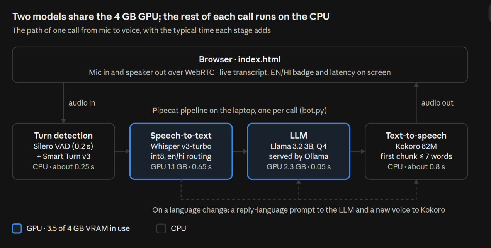

# Local Voice Assistant (English + हिन्दी)

A voice assistant that runs entirely on a laptop with open-weight models. You talk in the browser and it answers out loud. It keeps context across turns, lets you interrupt it mid-sentence, and switches between English and Hindi on its own each turn.

**Median latency is about 1.7 s** from the moment you stop speaking to the first audio of the reply, measured on an RTX 3050 Laptop GPU with 4 GB of VRAM.

**▶ Demo video:** [docs/demo.mp4](docs/demo.mp4) (3:17, recorded live on that laptop: memory, interruptions, the dental receptionist scenario)

| Requirement | How it's met |
|---|---|
| Speech-to-text | faster-whisper `large-v3-turbo` (int8_float16, GPU) |
| LLM | `llama3.2:3b` through Ollama (GPU) |
| Text-to-speech | Kokoro 82M (kokoro-onnx, CPU) |
| Voice conversation | Pipecat pipeline over WebRTC to a single-page web UI |
| Context | Full conversation history in Pipecat's `LLMContext`. After an interruption, only what was actually spoken is kept |
| Latency | Streaming at every stage; numbers below |
| **Bonus:** streaming | LLM tokens → clause-sized TTS chunks → audio frames, all streamed |
| **Bonus:** VAD | Silero VAD, plus Smart Turn v3 to decide when you've actually finished your turn |
| **Bonus:** interruptions | Start talking while the bot speaks and it stops at once |
| **Bonus:** multilingual | The language is detected per turn (en/hi). The LLM is told to reply in that language, and the voice switches to match |

It also has a **Scenario** dropdown that turns it into a dental clinic receptionist or an event company's follow-up caller (see [Scenarios](#scenarios)).

No hosted AI APIs are used. After the first model download, everything runs offline.

## Deliverables

| Deliverable | Where |
|---|---|
| Complete source code | This repository (see [Files](#files)) |
| Installation and setup instructions | [Quick start](#quick-start) and [Configuration](#configuration-environment-variables) |
| 2–3 minute demonstration video | [docs/demo.mp4](docs/demo.mp4) |
| Architecture diagram (STT → LLM → TTS) | [Architecture](#architecture) |
| Models selected, hardware requirements, observed latency | [Models selected](#models-selected), [Hardware requirements](#hardware-requirements), [Observed response latency](#observed-response-latency) |

## Architecture



Whisper and the LLM share the 4 GB GPU (3.5 GB in use); turn detection and Kokoro run on the CPU. Every stage streams into the next. Inside `bot.py`, the same path is one Pipecat pipeline per call:

```
 Browser (index.html)                               bot.py (one pipeline per session)
 ┌───────────────────┐   WebRTC audio   ┌──────────────────────────────────────────────────────────┐
 │ mic ──────────────┼─────────────────▶│ transport.input                                          │
 │                   │                  │   → LangWhisperSTT  ─ en/hi detect, transcribe (GPU)      │
 │                   │                  │   → user aggregator ─ Silero VAD + Smart Turn v3, context │
 │                   │                  │   → Ollama LLM      ─ llama3.2:3b, streamed tokens (GPU)  │
 │                   │                  │   → Kokoro TTS      ─ clause chunks, en/hi voice (CPU)    │
 │ speaker ◀─────────┼──────────────────┤ transport.output                                         │
 │ transcript, EN/HI │  RTVI data chan. │   → assistant aggregator ─ stores what was spoken         │
 │ badge, latency    │◀────────────────▶│ RTVI: transcripts, metrics, language override            │
 └───────────────────┘                  └──────────────────────────────────────────────────────────┘
```

When a turn's language differs from the previous one, `LangWhisperSTT` pushes two settings frames ahead of the transcript: a new LLM system prompt ("Reply only in Hindi, in Devanagari") and a Kokoro voice/language change (`af_heart` ↔ `hf_alpha`). Both take effect before that turn's reply.

## Models selected

| Stage | Model | Size and format | Memory in use | Runs on |
|---|---|---|---|---|
| Speech-to-text | Whisper large-v3-turbo via faster-whisper (`deepdml/faster-whisper-large-v3-turbo-ct2`) | 809M params, int8_float16, 1.6 GB download | 1.1 GB VRAM | GPU |
| LLM | Llama 3.2 3B Instruct via Ollama (`llama3.2:3b`) | 3.2B params, Q4_K_M, 2.0 GB download | 2.3 GB VRAM (4k context, q8 KV cache) | GPU |
| Text-to-speech | Kokoro v1.0 via kokoro-onnx (voices `af_heart`, `hf_alpha`) | 82M params, ONNX fp32, 338 MB | RAM | CPU |
| Voice detection | Silero VAD | small ONNX model | RAM | CPU |
| End of turn | Smart Turn v3 | small ONNX model | RAM | CPU |

## Hardware requirements

| Part | Tested on | Measured during a call | Recommended |
|---|---|---|---|
| GPU | NVIDIA RTX 3050 Laptop, 4 GB VRAM, driver 595.99 | 3.5 GB VRAM (LLM 2.3 GB + Whisper 1.1 GB) | 8 GB or more, so Kokoro can move to the GPU and a 7–8B LLM fits |
| CPU | AMD Ryzen 7 5800H, 8 cores / 16 threads | Kokoro at 0.35× real time, plus voice and turn detection | 8 cores or more |
| RAM | 12 GB | 4.1 GB (bot 3.3 GB + Ollama 0.8 GB) | 8 GB |
| Disk | NVMe SSD | about 9 GB (Python env 3.1, Ollama 2.1, Llama 1.9, Whisper 1.6, Kokoro 0.3 GB) | 10 GB free |
| OS | Ubuntu 26.04 LTS, Python 3.12 (uv), Chrome | no CUDA toolkit or sudo needed | Linux, recent NVIDIA driver |

## Scenarios

Pick a scenario in the dropdown before clicking **Connect**. Each call is one scenario; hang up and call again to switch. The language selector still works within a call.

| Scenario | Who the bot is | Try saying |
|---|---|---|
| General assistant | A general helper | Anything |
| Dental clinic receptionist | **Maya at Bright Smile Dental Clinic**, answering your call. Books visits from this week's open slots, takes your name and phone number, reads the booking back, quotes prices, and treats severe pain or swelling as an emergency | "I'd like to book a teeth cleaning this week." |
| Event follow-up call | **Riya from Stellar Events**, calling you back after you asked for a callback on the website. Asks about the event, date, city, guests and budget, then books a free consultation (video call or office visit) | "Yes, I'm planning my sister's wedding in December." |

The businesses, prices and doctors are made up, and the open slots are generated from today's date. Nothing is stored: a "booking" is the assistant confirming it out loud. Each scenario is a step-by-step system prompt plus an opening line in English and Hindi, all in [roles.py](roles.py). The LLM runs at temperature 0.3; at Ollama's default of 0.8, the 3B model skipped steps and its Hindi drifted into nonsense.

To add a scenario, add an entry to `ROLES` in `roles.py` and an `<option>` to the Scenario dropdown in `index.html`.

## Quick start

**Needs:**
- Linux with an NVIDIA GPU (4 GB of VRAM or more) and a recent driver. No CUDA toolkit is required; the cuBLAS and cuDNN libraries come as pip wheels.
- [uv](https://docs.astral.sh/uv/)
- [Ollama](https://ollama.com/download)

```bash
# 1. Get the code
git clone https://github.com/DemonBeastop/end-to-end-voice-ai-assistant.git
cd end-to-end-voice-ai-assistant

# 2. LLM server: model kept in VRAM, flash attention, q8 KV cache
OLLAMA_FLASH_ATTENTION=1 OLLAMA_KV_CACHE_TYPE=q8_0 OLLAMA_KEEP_ALIVE=-1 ollama serve &
ollama pull llama3.2:3b

# 3. Python env (Python 3.12 is pinned) and the assistant
uv sync
uv run bot.py          # first run downloads Whisper (~1.6 GB) and Kokoro (~350 MB)
```

Open **http://localhost:7860**, click **Connect**, allow the microphone, and talk. Use headphones: the browser's echo cancellation works, but headphones make barge-in cleaner.

> Start `bot.py` while nothing else is using the GPU. It loads the LLM **before** Whisper on purpose. If Whisper is already resident, Ollama offloads a third of the LLM to the CPU, which drops it from 71 to 10 tokens/s. `bot.py` logs a warning if that happens.

### Configuration (environment variables)

| Variable | Default | Notes |
|---|---|---|
| `LLM_MODEL` | `llama3.2:3b` | any Ollama model that fits in about 2.5 GB of VRAM next to Whisper |
| `OLLAMA_URL` | `http://localhost:11434` | |
| `WHISPER_MODEL` | `deepdml/faster-whisper-large-v3-turbo-ct2` | `small` uses less VRAM, but its Hindi is noticeably worse |
| `WHISPER_DEVICE` | `cuda` | `cpu` if VRAM is short (slower) |
| `WHISPER_COMPUTE` | `int8_float16` | use `int8` with `WHISPER_DEVICE=cpu` |
| `HOST` / `PORT` | `localhost` / `7860` | browsers allow the mic only on localhost or HTTPS |

## Observed response latency

These numbers come from an end-to-end run of the real UI. Headless Chrome played a scripted conversation through a fake microphone. Voice-to-voice is measured server-side by Pipecat's `UserBotLatencyObserver`, from the actual end of speech to the first bot audio frame.

| Turn | Voice-to-voice | STT | LLM TTFB | TTS first audio |
|---|---|---|---|---|
| "Hi, my name is … and I live in Delhi." | 1.77 s | 0.61 s | 0.12 s | 0.90 s |
| "What is my name, and which city do I live in?" | 1.53 s | 0.61 s | 0.04 s | 0.74 s |
| "भारत की राजधानी क्या है?" | 2.18 s | 0.69 s | 0.09 s | 1.16 s |
| "Tell me a long story about a brave little cat." | 1.59 s | 0.65 s | 0.07 s | 0.78 s |
| "Stop. What is two plus two?" (barge-in) | 1.59 s | 0.62 s | 0.03 s | 0.79 s |

Across three full runs (15 turns): **median 1.71 s, range 1.15–2.18 s**. TTS on the CPU is the largest share; Hindi chunks run longer.

The first measured run, before these fixes, took 2.0–5.6 s per turn, and some turns were answered twice. The optimizations, in order of impact:
1. **Stopped premature replies.** Whisper's transcript raced Pipecat's default 1 s wait, so the LLM sometimes fired on partial text and had to restart. Fixed by holding a segment's transcript while the user is still talking, and raising that wait to a 2 s safety net, which only matters if no transcript arrives.
2. **Shorter first TTS chunk.** Kokoro on the CPU runs at about 0.35× real time and synthesizes a chunk before playing it. The first chunk of each reply is now cut at the first clause or 7 words (4 in Hindi, whose words take longer to say).
3. **Single Whisper encoder pass** for both language detection and decoding: 0.82 s → 0.42 s.
4. **LLM 100% on the GPU** (load order), q8 KV cache, flash attention, kept resident.

## Limitations

- **The 3B LLM is the weak link.** Facts and reasoning are basic, and its Hindi is understandable but simple. On a GPU with 8 GB or more, set `LLM_MODEL` to a 7–8B model.
- **Code-mixed Hinglish** is transcribed as whichever language dominates each turn.
- **One session at a time.** All sessions share one GPU and one Whisper model.
- **Hallucination filter.** large-v3-turbo always reports `no_speech_prob ≈ 0`, so noise like coughs is filtered by average log-prob instead (`MIN_AVG_LOGPROB` in `lang.py`). Raise it toward -0.5 if a noisy mic produces phantom "you" turns.
- **Full history is sent every turn.** That's fine for demo-length chats; add trimming before hour-long sessions.

## Files

| File | What it does |
|---|---|
| `bot.py` | FastAPI server (`/`, `/api/offer`), Pipecat pipeline, preflight checks, `ClauseAggregator` |
| `lang.py` | `LangWhisperSTT`: single-pass Whisper, en/hi routing, segment merging |
| `roles.py` | Scenarios: system prompts, opening lines and open slots |
| `index.html` | Web UI: Pipecat JS client from a CDN, no build step |
| `docs/architecture.png` | Architecture diagram: STT → LLM → TTS, with where each model runs |
| `docs/demo.mp4` | The demonstration video |
