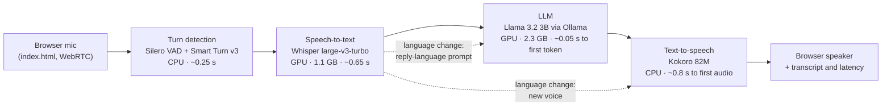

# Local Voice Assistant: tech stack

The assistant runs entirely on one laptop with a 4 GB GPU. Pipecat streams the browser's audio through Whisper and Llama 3.2 3B on the GPU and Kokoro on the CPU. The bot starts replying a median 1.71 s after the caller stops talking. How each part was tuned to fit is in [tuning-log.md](tuning-log.md).

## At a glance

Each stage streams into the next. If the caller starts talking while the bot speaks, Kokoro stops and the LLM request is cancelled at once.

## Models selected

There are five open-weight models. The two large ones use 3.5 of the 4 GB of VRAM during a call; the three small ones run on the CPU.

| Stage | Model | Size and format | Memory in use | Why this one |
|---|---|---|---|---|
| Speech-to-text | Whisper large-v3-turbo, via faster-whisper (`deepdml/faster-whisper-large-v3-turbo-ct2`) | 809M parameters; int8 weights with float16 compute; 1.6 GB download | 1.1 GB VRAM | Strong Hindi and English, and its 4-layer decoder makes it much faster than large-v3 |
| LLM | Llama 3.2 3B Instruct, via Ollama (`llama3.2:3b`) | 3.2B parameters; Q4_K_M; 2.0 GB download | 2.3 GB VRAM, with a 4,096-token context and an 8-bit KV cache | Officially supports Hindi; the largest instruct model that fits beside Whisper; 71 tokens/s |
| Text-to-speech | Kokoro v1.0, via kokoro-onnx | 82M parameters; ONNX fp32; 338 MB with voices | CPU RAM | The most natural small open TTS; voices `af_heart` (English) and `hf_alpha` (Hindi) |
| Voice detection | Silero VAD | Small ONNX model, bundled with Pipecat | CPU RAM | Fast, standard speech detector |
| End of turn | Smart Turn v3 | Small ONNX model, bundled with Pipecat | CPU RAM | Tells a finished sentence from a pause |

## Hardware requirements

The app was built and measured on a mid-range gaming laptop. The real minimum is an NVIDIA GPU with 4 GB of VRAM.

| Part | Tested on | Measured use during a call | Recommended |
|---|---|---|---|
| GPU | NVIDIA RTX 3050 Laptop, 4 GB VRAM, driver 595.99 | 3.5 GB VRAM (LLM 2.3 GB, Whisper 1.1 GB) | 8 GB or more: Kokoro could move to the GPU (it ran out of memory on 4 GB), and a 7–8B LLM would fit |
| CPU | AMD Ryzen 7 5800H, 8 cores / 16 threads | Runs Kokoro at 0.35× real time, plus voice and turn detection | 8 cores or more; fewer cores slow the TTS, which is the largest share of each turn |
| RAM | 12 GB | 4.1 GB (bot process 3.3 GB, Ollama 0.8 GB) | 8 GB total |
| Disk | NVMe SSD | About 9 GB: Python env 3.1 GB, Ollama 2.1 GB, Llama 1.9 GB, Whisper 1.6 GB, Kokoro 0.3 GB | 10 GB free |
| Software | Ubuntu 26.04 LTS, Python 3.12 via uv, Ollama, Chrome | No CUDA toolkit or sudo needed: the CUDA libraries come as pip packages | Any Linux with a recent NVIDIA driver, and a browser with mic access |

A CPU-only setup should work with `WHISPER_DEVICE=cpu`, but it wasn't tested and would be much slower.

## Observed latency

The bot starts speaking a median 1.71 s after the caller stops (15 turns, range 1.15–2.18 s). Before tuning it took 2.0–5.6 s.

Pipecat measured each turn on the server, from the real end of speech to the first audio frame sent. Headless Chrome on the same laptop played scripted speech into a fake microphone, so network time is near zero.

**Per turn, from the last general-assistant run (seconds):**

| Caller said | Voice-to-voice | STT | LLM first token | TTS first audio |
|---|---|---|---|---|
| "Hi, my name is … and I live in Delhi." | 1.77 | 0.61 | 0.12 | 0.90 |
| "What is my name, and which city do I live in?" | 1.53 | 0.61 | 0.04 | 0.74 |
| "भारत की राजधानी क्या है?" | 2.18 | 0.69 | 0.09 | 1.16 |
| "Tell me a long story about a brave little cat." | 1.59 | 0.65 | 0.07 | 0.78 |
| "Stop. What is two plus two?" (interrupting) | 1.59 | 0.62 | 0.03 | 0.79 |

Text-to-speech takes the largest share of every turn, then Whisper; the LLM's first token arrives in under 0.13 s. The stage columns don't add up to the total, because the stages overlap and the 0.2 s of silence detection comes on top.

**By type of call:**

| Call | Turns | Voice-to-voice |
|---|---|---|
| General assistant, 3 runs | 15 | Median 1.71 s, range 1.15–2.18 s |
| Dental receptionist, English | 5 | 1.60–2.56 s |
| Dental receptionist, Hindi | 2 | 1.66–2.18 s |
| Event follow-up, English | 5 | 1.47–1.97 s |

## The stack

Everything is open source and runs locally. Only Whisper and the LLM use the GPU; everything else runs on the CPU to stay inside 4 GB of VRAM.

| Layer | What we use | Runs on | Why this one |
|---|---|---|---|
| Web UI | One `index.html` with Pipecat's JS client (client-js 1.13.1, small-webrtc-transport 1.10.8), loaded from a CDN | Browser | No build step. Shows the live transcript, an EN/HI badge, latency per reply, and the scenario and language dropdowns |
| Audio transport | WebRTC through Pipecat's SmallWebRTC (aiortc on the server) | Browser ↔ laptop | Low-latency audio with the browser's echo cancellation, and no third-party media server. A data channel carries transcripts and metrics (the RTVI protocol) |
| Web server | FastAPI + uvicorn | CPU | Serves the page and the WebRTC offer endpoint; starts one Pipecat pipeline per call |
| Orchestration | Pipecat 1.12 | CPU | Streams audio and text between the stages, with built-in voice detection, turn-taking, interruptions, conversation memory and latency metrics |
| Voice detection | Silero VAD, 0.2 s stop delay | CPU | Spots when the caller starts and stops talking; starting to talk interrupts the bot |
| End of turn | Smart Turn v3 | CPU | Judges from the audio whether the caller has finished or is only pausing mid-sentence |
| Speech-to-text | faster-whisper `large-v3-turbo`, int8_float16 | GPU | Best Hindi of the Whisper models that fit; about 0.42 s per turn with our single-pass decoding |
| LLM server | Ollama, with flash attention and an 8-bit KV cache | GPU | Simple model management; keeps the model loaded and serves an OpenAI-style streaming API |
| LLM | Llama 3.2 3B Instruct, Q4_K_M | GPU | Officially supports Hindi; 71 tokens/s when fully on the GPU |
| Text-to-speech | Kokoro 82M (kokoro-onnx), voices `af_heart` (English) and `hf_alpha` (Hindi) | CPU | The most natural-sounding small open TTS, with English and Hindi voices; 0.35× real time on this CPU |
| GPU libraries | NVIDIA cuBLAS 12 and cuDNN 9 as pip packages | — | Whisper needs them; pip packages avoid a system CUDA install, which needs sudo |
| Python tooling | Python 3.12 with uv | — | System Python 3.14 is too new for the ML libraries; uv pins the version and locks dependencies |

## How one turn works

From the caller's last word to the bot's first audio takes a median 1.71 s. Every stage streams into the next instead of waiting for it to finish.

1. **Capture.** The browser records the mic with echo cancellation on and sends 20 ms audio frames over WebRTC.
2. **Barge-in.** Silero VAD marks the start of speech. If the bot is talking, it stops at once and the pending LLM request is cancelled.
3. **End of turn (about 0.25 s).** VAD waits for 0.2 s of silence, then Smart Turn v3 checks whether the sentence sounds finished. A pause mid-sentence keeps the turn open.
4. **Speech-to-text (about 0.65 s).** Whisper encodes the audio once and uses that one pass both to pick the language (English or Hindi) and to transcribe in it. If the caller is still talking, the text is held and joined with the next piece, so the turn never ends on half a sentence.
5. **Language switch (only when it changes).** Ahead of the transcript, a new system prompt ("Reply only in Hindi…") goes to the LLM and a new voice goes to Kokoro.
6. **LLM (about 0.05 s to first token).** The transcript joins the conversation history, and Ollama streams Llama's reply at about 70 tokens/s.
7. **First audio (about 0.8 s).** Tokens are cut into chunks: the first chunk ends at the first comma or after 7 words (4 in Hindi). Kokoro synthesizes it and the audio streams back. Later chunks are synthesized while earlier ones play.
8. **Memory.** Only what was actually spoken goes into the history, so an interrupted reply is remembered as interrupted. The browser shows each sentence as it is spoken, plus the latency line.

## English and Hindi

The language is picked fresh on every turn, and the reply language and voice follow it, so a caller can switch mid-call.

- **Detection.** Whisper scores every language for the turn; we compare only English against Hindi. Urdu's score is added to Hindi, because spoken Hindi and Urdu sound almost the same and Whisper often labels Hindi as Urdu.
- **Transcription.** Whisper then transcribes in the chosen language, so Hindi comes out in Devanagari script.
- **Reply language.** The system prompt ends with an explicit line: "Reply only in English" or "Reply only in Hindi, written in Devanagari script." Without it, the 3B model answered English questions in romanized Hindi.
- **Voice.** Kokoro switches between `af_heart` and `hf_alpha`, and between English and Hindi pronunciation rules.
- **Override.** The Language dropdown (Auto, English, हिन्दी) can force one language. It also picks the language of the greeting and the starting voice.
- **Pacing.** Hindi words take about twice as long to say, so the first spoken chunk of a Hindi reply is capped at 4 words instead of 7.
- **Limit.** Code-mixed Hinglish is transcribed as whichever language dominates the turn.

## Scenarios

A Scenario dropdown turns the same pipeline into a dental receptionist or an event company's sales caller. Only the system prompt and the opening line change.

| Scenario | Who the bot is | What the call does |
|---|---|---|
| General assistant | A helpful voice assistant | Free conversation |
| Dental clinic receptionist | Maya at Bright Smile Dental Clinic, answering a call | Reason for the visit → an open slot → name → phone number → reads the booking back. Severe pain or swelling gets today's 6:30 PM emergency slot |
| Event follow-up call | Riya from Stellar Events, returning a website callback request | Good time to talk? → name → event and date → city and guests → budget → a free consultation slot, as a video call or office visit |

- **How it is wired.** The browser sends the chosen scenario and language with the WebRTC connection request. The server checks both against the allowed values and starts the call with that scenario's prompt, voice and greeting. Switching scenario means hanging up and calling again.
- **What a scenario is.** An entry in `roles.py`: a step-by-step system prompt, made-up business facts (hours, doctors, prices) and a greeting in English and Hindi. Shared rules are added to every prompt: plain spoken sentences, one question at a time, phone numbers read digit by digit.
- **No database.** Open slots are generated from today's date (the next three working days, Sundays closed), and a booking is only confirmed out loud.
- **Keeping a 3B model on script.** The steps are numbered, and the LLM runs at temperature 0.3. At Ollama's default of 0.8 it skipped steps and its Hindi turned into nonsense.
- **Adding one.** Add an entry to `ROLES` in `roles.py` and an option to the dropdown in `index.html`.

## Why not the alternatives

Most rejections came down to the 4 GB GPU or a measured slowdown on this laptop.

| Part | Alternative | Why not |
|---|---|---|
| Pipeline | Hand-written FastAPI + WebSocket pipeline | About 5× the code, concentrated in the hardest parts: cancelling on interruptions and audio timing |
| Pipeline | Pipecat with a terminal mic (LocalAudioTransport) | No web interface, which the task requires |
| Transport | Plain WebSocket audio | No browser echo cancellation or jitter buffering; WebRTC gives both |
| LLM | Gemma 3 4B | 3.3 GB; doesn't fit next to Whisper |
| LLM | Same model, partly on the CPU | 10 tokens/s instead of 71, and a 22 s first prompt |
| Speech-to-text | Whisper `small` | Much weaker Hindi |
| Speech-to-text | Detect the language, then transcribe (two passes) | 0.82 s per turn instead of 0.42 s |
| Text-to-speech | Piper | 8× faster, but sounds noticeably more robotic |
| Text-to-speech | Kokoro int8 | 5× slower on this CPU (real-time factor 1.5–1.9) |
| Text-to-speech | Kokoro on the GPU | Ran out of VRAM next to Whisper and the LLM |
| Web UI | Pipecat's prebuilt page | No language badge, latency line or scenario dropdown |

## Project files

The whole app is about 450 lines of Python and one HTML page.

| File | What it does |
|---|---|
| `bot.py` | Web server; startup checks (Ollama running, model pulled, LLM fully on the GPU); the pipeline for each call; the TTS chunking rules |
| `lang.py` | The Whisper wrapper: single-pass decoding, English/Hindi routing, joining split turns, filtering hallucinations |
| `roles.py` | The scenarios: system prompts, greetings and generated open slots |
| `index.html` | The web page |
| `test_voice.py` | Checks for the custom logic; run with `uv run python test_voice.py` |
| `docs/` | This explanation, the tuning log and an architecture decision record |

To run it, start `ollama serve` with flash attention, an 8-bit KV cache and keep-alive on, then run `uv sync` and `uv run bot.py`, and open `http://localhost:7860`.
